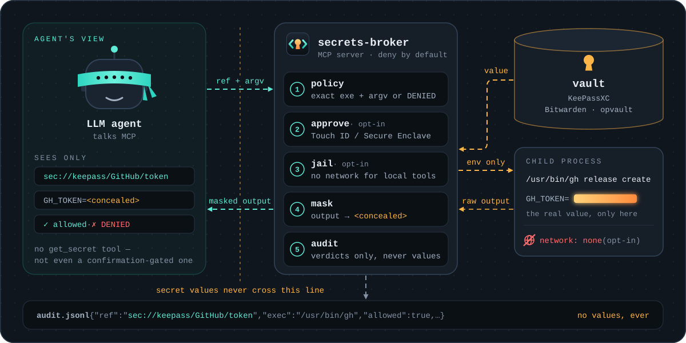

<p align="center">
  
</p>

Your agent can **use** your credentials without ever **seeing** them — and a
credential it uses for one command can't be replayed against another.

Status: **v0.3 working prototype** (see [SPEC.md](SPEC.md) for design).

> **Read this first.** The security guarantees hold in *isolated mode*
> (`sudo sb install`). In the default *single-uid mode* the broker runs as you,
> so anything else running as you — including an agent with a shell — can
> bypass it. `sb doctor` tells you which mode you're in.
> See [docs/security.md](docs/security.md).

## How it works

<p align="center">
  
</p>

The agent only ever holds a **reference** (`sec://keepass/GitHub/token`). The
broker checks the exact command, asks a human if the secret is gated, and only
then resolves the value — straight into one child process's environment. What
comes back is masked; what gets logged is the verdict. Step by step, with
every way a call is refused:
[docs/architecture.md](docs/architecture.md#life-of-an-exec_with_secret-call).

## Why secrets-broker

**Every secret is bound to a destination.** Most secret-injection tools scope
access by account or vault; this binds each secret to where it may go. A token
approved for `gh release create` cannot be replayed as
`gh api /user`, piped into `sh`, or handed to `curl`. You authorize an exact
executable and an exact argv prefix; everything else is denied by default.

```bash
sb allow sec://keepass/GitHub/token /usr/bin/gh -- release create
```

**A local tool can be denied the network entirely.** `--no-network` runs the
child — and every process it spawns — with no network access at all, so a
credential released to a local formatter, linter or build cannot be exfiltrated
by the very tool it was given to. `sandbox-exec` on macOS, an empty network
namespace on Linux; if neither can be applied the command is refused rather
than run unconfined.

```bash
sb allow sec://keepass/NPM/token /usr/local/bin/my-build --no-network
```

**There is no read tool. Not even a confirmation-gated one.** `create_secret`
generates a credential and returns only a reference. The value goes from the
vault into one child process's environment and nowhere else — never into the
model's context, the transcript, or a log. Output is masked on the way back.

**Human-in-the-loop for the sensitive ones.** Gate a secret and it isn't used
until a human approves *that exact command* (Touch ID / Secure Enclave). It is
the one gate an agent cannot satisfy on its own.

**Every use is audited** — ref, executable, allow/deny, reason. Never values.

**One vault, shared by you and your agent.** You manage secrets in the
KeePassXC app; the agent reads and creates them through the broker; each side
sees the other's changes. Local-first: no cloud account required, and your
vault never leaves the machine.

**Bring your existing secrets.** `sb import` discovers credentials already in
your dotfiles (AWS, netrc, `.npmrc`, docker, gh, stripe, ~30 more) and moves
them into the vault; read-only scan, values never printed.

**Browser autofill for humans too**, via the KeePassXC-Browser extension —
from any backend, including `.opvault`.

More scenarios: [docs/use-cases.md](docs/use-cases.md).

## How it compares

|  | 1Password CLI (`op run`, shell plugins) | **secrets-broker** |
|---|---|---|
| injects secrets into a child process's environment | yes | yes |
| masks secrets in the child's output | yes, by default | yes, by default — also any 6+ character fragment of a secret |
| what limits where a secret can go | which account, vaults or service account the session can reach | **the exact executable + argv prefix bound to each secret** |
| deny the process using a secret all network access | no documented option | **yes**, per binding (macOS + Linux) |
| a command that prints a secret's value | yes (`op read`) | **none** |
| human approval | biometric, per terminal session (10 min idle, 12 h max) | optional per secret: **every use**, prompt names the full command (macOS) |
| activity record | CLI activity log in the desktop app; item usage via the Events API (Business) | local JSONL of every exec attempt, allowed or denied, with the reason |
| where secrets live | a 1Password account | local KeePassXC (.kdbx) or OPVault files, or Bitwarden/Vaultwarden |

<sub>1Password column as described in 1Password's public developer docs —
[`op run`](https://developer.1password.com/docs/cli/reference/commands/run/),
[`op read`](https://developer.1password.com/docs/cli/reference/commands/read/),
[app integration security](https://developer.1password.com/docs/cli/app-integration-security/),
[CLI activity log](https://developer.1password.com/docs/cli/app-integration/#track-1password-cli-activity),
[Events API item usage](https://www.1password.dev/events-api/item-usage-actions) —
checked October 2026. 1Password is a trademark of AgileBits Inc.;
secrets-broker is an independent project, not affiliated with or endorsed by
AgileBits.</sub>


## Get started

Isolated mode is **one command** — it creates the service account, installs the
daemon, and prompts you for the vault master password at the end:

```bash
sudo sb install --dry-run --vault keepass:$HOME/Shared/agent.kdbx   # review
sudo sb install           --vault keepass:$HOME/Shared/agent.kdbx
```

Pick by how much you trust the agent's own account:

- **Isolated mode (recommended)** — a real boundary; a **human** runs the
  command above and types the master password. The agent can't, by design.
- **Single-uid mode (quick)** — not a boundary, but your **agent can set it up
  itself** unattended. Good for trying it and for development.

Full walkthrough for both (macOS and Linux), MCP registration, and uninstall:
**[docs/setup.md](docs/setup.md)**.

**Agent on a VPS or Mac mini, you on a laptop?** Keep one vault on both:
KeePassXC on your computer, the broker on the always-on box, and
[Syncthing](https://syncthing.net) between them — direct, encrypted, no cloud
account. You edit entries as usual, the agent sees them seconds later, and what
it stores shows up in your KeePassXC. Your agent can set up the whole server
side; you install Syncthing on your computer and accept the pairing.
See [Syncing the vault between machines](docs/setup.md#syncing-the-vault-between-machines).

## For agents (self-setup)

Handed this repo by a user? Read **[AGENTS.md](AGENTS.md)** — it has the
deterministic single-uid setup you can run yourself, the isolated-mode steps you
must hand to the human instead, and how to behave once it's wired up (use the
broker; never ask for or store plaintext secrets).

## Adapters

| adapter | ref | read | write | backend |
|---|---|---|---|---|
| keepass | `sec://keepass/<group>/<item>/<field>` | yes | yes | **recommended** — .kdbx (kdbx4/Argon2); one vault a human (KeePassXC app) and the agent both read+write live |
| bitwarden | `sec://bw/<item>/<field>` | yes | yes | `bw` CLI vs Bitwarden/Vaultwarden. **Verified end-to-end**; server-mediated, so human and agent share items live |
| opvault | `sec://opvault/<item>/<field>` | yes | yes | 1Password 7 standalone vault dir |

Enpass was removed in v0.3: its sqlcipher sidecar cannot open Enpass 6.8+
vaults, and shipping an adapter that fails on current versions is worse than
not shipping one.

## Docs

- [Setup](docs/setup.md) — install both modes, both platforms, MCP, uninstall, browser
- [Security & threat model](docs/security.md) — what holds, what doesn't
- [Architecture & internals](docs/architecture.md) — components, tool profiles, testing
- [Approval](docs/approval.md) · [Use cases](docs/use-cases.md)
- [SPEC.md](SPEC.md) — design

## Non-goals

Not a vault. No cloud, no accounts, no sync. No `get_secret` tool — ever.

## License

See [LICENSE](LICENSE).
