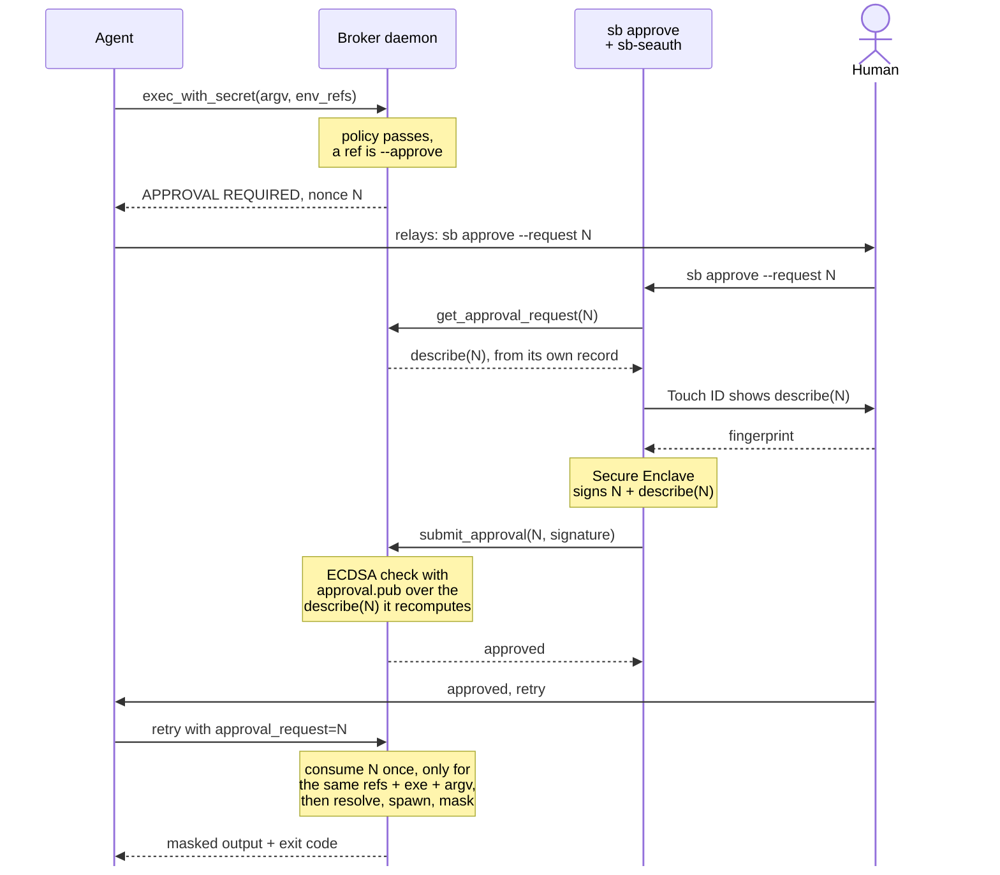

# Human approval for gated secrets

A ref marked `sb allow … --approve` requires a person to authorize each use.
This exists so that even a broker the agent talks to over MCP cannot release a
marked secret without a fresh human decision the agent cannot forge.

## Where it stands

| mode | approval |
|---|---|
| single-uid (`sb-approve` in your session) | **works** — a SecurityAgent prompt per use, in your own login session |
| isolated (daemon under its own uid) | **works only with a code-signed `sb-seauth`** — a Secure Enclave signature over the request nonce, verified against a key registered at install |

`sb doctor` reports which one is in effect. With no key registered — including
on any machine where `sb-seauth` is not code-signed — isolated mode fails
closed (marked refs are denied), and single-uid mode remains available.

## The code-signing requirement (important)

Persistent Secure Enclave keys live in the data-protection keychain, which
macOS only lets a process use if it is code-signed with an
`application-identifier` / `keychain-access-groups` entitlement. That entitlement
requires a real signing identity (an Apple Developer team; a free personal team
via Xcode is enough). An ad-hoc?signed or unsigned `sb-seauth` gets
`errSecMissingEntitlement` (-34018) creating the key, and claiming the
entitlement ad-hoc gets the process killed. There is no ad-hoc workaround.

So to enable isolated-mode approval, build and sign `sb-seauth`:

```
swiftc -O -o bin/sb-seauth cmd/sb-seauth/main.swift
codesign --entitlements cmd/sb-seauth/entitlements.plist \
  -s "Apple Development: you@example.com (TEAMID)" -f bin/sb-seauth
```

and set `keychain-access-groups` in `entitlements.plist` to
`TEAMID.dev.secretsbroker`. Without a signing identity, isolated-mode approval
is unavailable by construction; use single-uid mode, which prompts directly and
needs no entitlement.

## Why isolated-mode approval is hard (all verified live on macOS 27)

The daemon has no GUI session, so it cannot draw a prompt itself
(`errAuthorizationInternal`, -60007). Approval therefore has to happen in a
process that *does* have a session and be conveyed to the daemon. Every
attempt to convey it failed a real test:

1. **Shared authorization right, verified from the daemon via an external
   form.** Authorization Services caches the admin credential inside the
   authorization and reuses it for *any* admin-requiring right. A fingerprint
   given for request A verified request B. `timeout=0` stops the reuse but
   also stops the daemon re-checking at all — the two failures are the same
   mechanism at its two settings.
2. **One authorization right per request (`dev.secretsbroker.req.<nonce>`),
   created by a root helper.** Same reuse: the credential is shared across
   rights regardless of name. Proven exploitable end to end — a grant for one
   nonce approved another within the timeout.
3. **Identify the calling process instead of trusting the token.** Spoofable
   across uids: the daemon cannot inspect another user's process, and `ps`
   reports a caller-chosen `argv[0]`. Also racy against `exec`.
4. **LocalAuthentication (`LAContext`), which *does* force a fresh biometric
   per call with no reuse.** Biometric enrollment is per-user: it works as the
   console user and returns "Biometry is not enrolled" as root or as the
   service account — the only identities the daemon could verify from.

The tension that defeats all four: a fresh biometric requires the console
user's enrollment, so it must run as that user — the same uid the agent runs
as — and a successful `LAContext` produces no transferable proof, while the
one transferable proof (an authorization external form) is reusable.

## The design that resolves it: Secure Enclave signing

A biometric that yields transferable, request-bound proof is exactly a
WebAuthn/passkey signature, and macOS exposes the primitive directly.

- **Setup (once, as the console user, no root):** create a P-256 key in the
  Secure Enclave whose access control requires a biometric *per use*
  (`.biometryCurrentSet` + `.privateKeyUsage`), non-exportable. Register its
  public key with the daemon in a root-owned file.
- **Approve:** the daemon returns the request's nonce (covering every gated
  ref of the exec). A user-session helper signs that nonce with the SE key;
  the signature forces a fresh Touch ID showing the request's description. The
  signature is handed to the daemon.
- **Verify:** the daemon checks the signature over the exact nonce with the
  registered public key — pure Go ECDSA, **no root anywhere**. A signature for
  one nonce cannot approve another, and each signing is a fresh biometric.

This binds (the signed payload *is* the request), does not reuse (SE biometry
per use), needs no root (verification is a public-key check), and is the same
primitive the browser side would use for passkeys.

## As built

The isolated-mode round trip, end to end:



The nonce expires after `SB_APPROVAL_TTL` (default 5 minutes). Single-uid mode
skips the round trip: the broker prompts for Touch ID itself (`sb-approve`),
and a grant stands for the same ref and command for that same TTL.

- `cmd/sb-seauth` (Swift, runs as the console user): `keygen` creates the
  P-256 Secure Enclave key (`.biometryCurrentSet` + `.privateKeyUsage`,
  non-exportable) and prints its public half; `sign <nonce> <describe>` forces
  a fresh Touch ID showing the description and signs `nonce + "\n" + describe`.
- `sudo sb install` runs `sb-seauth keygen` as the console user and writes the
  public key to `/usr/local/etc/secrets-broker/approval.pub` (root-owned).
- The daemon loads that key (`SB_APPROVAL_PUBKEY`) and, for a gated exec,
  returns `APPROVAL REQUIRED` with a nonce covering every gated ref.
- `sb approve --request <nonce>` fetches the request from the daemon
  (`get_approval_request`), signs it via `sb-seauth`, and submits the
  signature (`submit_approval`). The daemon verifies the signature over
  `nonce + "\n" + describe`, recomputing `describe` from its own record — so a
  signature only verifies if the human saw exactly the command that will run.
- Verification is Go ECDSA against the registered public key. No root, no
  reusable credential, and a signature for one request cannot approve another.

Both properties were the failure modes of the earlier attempts: the signed
description defeats a misleading prompt, and the per-request nonce defeats
cross-request reuse.
