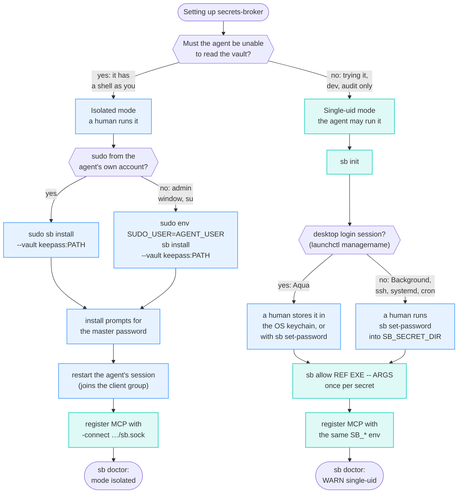

# Setup

Two ways to run it — pick by how much you trust the agent's own account:

- **Isolated mode (recommended, a human sets it up).** A real boundary: the
  broker runs as its own service account, so an agent — even with a shell —
  can't reach the vault, master password, policy or audit log. Requires `sudo`
  and you type the master password. **The agent cannot set this up for you;
  that is the point.**
- **Single-uid mode (quick, your agent can set it up).** The broker runs as
  you, so it is *not* a boundary — anything running as you can bypass it. Good
  for trying it out, for development, and for letting an agent wire everything
  up unattended. See [AGENTS.md](../AGENTS.md).

Not sure which, or where the master password goes? Blue steps are a human's;
mint steps the agent may run.



Build the binaries first (`make build`, or the `go build`/`swiftc` lines in the
[Makefile](../Makefile)).

## Isolated mode (recommended) — KeePassXC, shared by you and the agent

```bash
# 1. make a vault (KeePassXC app: File > New Database), or headless:
keepassxc-cli db-create ~/Shared/agent.kdbx --set-password

# 2. install the isolated daemon, pointed at the .kdbx (creates the
#    _secretsbroker service account). Preview first:
sudo sb install --dry-run --vault keepass:$HOME/Shared/agent.kdbx
sudo sb install           --vault keepass:$HOME/Shared/agent.kdbx

# 3. share the vault between your account and the service account: one group
#    both belong to, file group-readable/writable (0660).
sudo dseditgroup -o create sbvault
sudo dseditgroup -o edit -a _secretsbroker -t user sbvault
sudo dseditgroup -o edit -a "$USER" -t user sbvault
chgrp sbvault ~/Shared/agent.kdbx && chmod 660 ~/Shared/agent.kdbx
#    (restart the KeePassXC app once so it picks up the new group)

# 4. (install already prompted you for the vault password and stored it
#     0600, service-account-owned. Re-run this only to CHANGE it:)
#     sudo sb set-password keepass $HOME/Shared/agent.kdbx

# 5. let the agent create secrets too (default: writes denied). add-fields
#    also lets it add a missing field to an existing entry — e.g. a login's
#    TOTP seed — without ever overwriting one.
sudo sb write-allow keepass create,add-fields

# 6. bind a secret to a command (destination binding: exec AND args)
sudo sb allow sec://keepass/GitHub/token /usr/bin/gh -- api /user

# 7. verify
sb doctor        # expect: mode isolated
```

Register the daemon with your MCP client. For Claude Code:

```bash
claude mcp add secrets-broker -- /usr/local/libexec/secrets-broker/secrets-broker-mcp -connect /usr/local/var/secrets-broker/run/sb.sock
```

Now both sides share one vault: you manage secrets in the KeePassXC app, the
agent uses them via `exec_with_secret` / profiles and can create new ones with
`create_secret` — and each sees the other's changes. The broker preserves the
vault file's group and mode when it writes, so a shared `0660`/`sbvault`
database stays readable by the app; if KeePassXC ever saves it back as `0600`,
`sb doctor` flags it and `chmod 660` restores sharing.

### Uninstall

```bash
sudo sb uninstall            # remove daemon, binaries, service account; keep your data
sudo sb uninstall --purge    # also delete policy, audit log, stored passwords, vault dir
sb uninstall --dry-run       # preview (no root needed)
```

## Single-uid mode (quick / agent-installable)

```bash
sb init
SB_SECRET_DIR=~/.secrets-broker/secrets sb set-password keepass ~/agent.kdbx
sb allow sec://keepass/GitHub/token /usr/bin/gh -- api /user
sb write-allow keepass create,add-fields   # new entries + missing fields; never overwrites
SB_KEEPASS_DB=~/agent.kdbx SB_SECRET_DIR=~/.secrets-broker/secrets \
  SB_POLICY_FILE=~/.secrets-broker/policy.json ./secrets-broker-mcp
```

The macOS keychain works too —
`security add-generic-password -s secrets-broker -a "keepass:$HOME/agent.kdbx" -w`
— **but only if the broker runs in a GUI login session.** Under launchd's
`Background` session (and over ssh, systemd or cron) macOS refuses every
keychain call, reads included, with "User interaction is not allowed", so an
item created by hand is still unreadable. `launchctl managername` printing
`Background` means use `sb set-password`. Resolution order is
`SB_*_PASSWORD` env → `SB_SECRET_DIR` file (0600) → OS keychain.

`sb doctor` warns that this is not a boundary: the broker runs as you, so
anything running as you can bypass it. Fine for development and for auditing
what an agent does; not the answer to "can the agent read my password".


## Browser autofill (humans and agents)

The broker speaks the
[KeePassXC-Browser protocol](https://github.com/keepassxreboot/keepassxc-browser/blob/master/keepassxc-protocol.md),
so the published KeePassXC-Browser extension fills credentials from **any**
adapter — including `.opvault`, which lost its browser filler when 1Password 7
went EOL. Nothing new to install in the browser.

```bash
sudo sb install --vault opvault:/path/to/agent.opvault   # installs the host, root-owned
sb allow sec://opvault/Proton/password --host=https://mail.proton.me
# install KeePassXC-Browser, click Connect; then, as a human:
sudo sb browser list                  # the new association shows as PENDING
sudo sb browser approve <id>          # or --agent for a browser an agent drives
```

- **An association is a principal.** An unapproved browser gets nothing;
  approval is a human act (the daemon has no GUI to auto-approve in). An id
  presented with the wrong identity key is refused.
- **Origin-scoped.** `get-logins` returns only refs the policy binds to that
  exact origin (`--host=`), never an inventory of the vault.
- **Audited**, and the native-messaging manifest is installed **root-owned** in
  `/Library/…/NativeMessagingHosts` — the per-user dirs are agent-writable, so a
  manifest there could repoint the extension at a host the agent controls.

Known limit: `get-logins` hands the credential to the extension in the clear —
that is the protocol, and it is what lets the extension type it. Fine for a
human; for an agent driving the same browser over CDP, that path is only as
strong as the browser runtime being outside the agent's control.

### Single-uid: an agent's own browser profile (no sudo)

An agent driving Chrome over CDP (browser-harness, Playwright, Puppeteer) uses
a **dedicated profile**, not your everyday browser. Chrome only reads
native-messaging manifests from that profile's own directory or the
system-wide one, so point the host at the profile:

```bash
# 1. install the manifest into the agent's Chrome profile
sb browser install-host --dir ~/.config/assistant/chrome-profile

# 2. run the broker with the browser socket enabled (same flag the MCP
#    registration uses; the default path matches what install-host wrote).
#    It also serves MCP on stdio: started with stdin from /dev/null it sees
#    EOF and exits, and the socket refuses every connection. Let your MCP
#    client launch it, or give it an open stdin.
secrets-broker-mcp -browser-socket ~/.secrets-broker/browser.sock

# 3. install KeePassXC-Browser in that profile, from the Chrome Web Store:
#    https://chromewebstore.google.com/detail/keepassxc-browser/oboonakemofpalcgghocfoadofidjkkk
#    Open the extension, click Connect, give the association a name.
#    (No GUI? See "Installing the extension headlessly" below.)

# 4. approve it — with agent scope, and bind refs to exact origins
sb browser list                        # shows PENDING
sb browser approve <id> --agent
sb allow sec://keepass/GitHub/password --host=https://github.com --agent-browser
```

Check it end to end without a browser: the proxy is what Chrome launches, so
running it directly exercises the real path.

```bash
sb browser list     # after Connect, the association must appear
```

Two things to be clear about:

- **This manifest is NOT a boundary.** It lives in a directory your own user
  can write, so an agent running as you could repoint it. That is the same
  trade-off single-uid mode already makes (`sb doctor` says so). `sudo sb
  install` is the root-owned form, and the only one that resists a
  prompt-injected agent.
- **Approve with `--agent`, and bind every ref to an origin.** A ref with no
  `--host=` is fillable nowhere, and `--agent-browser` is off by default: an
  agent-driven browser gets nothing unless you say so per credential.

### Installing the extension headlessly

An agent's Chrome often runs headless, or in a session with no desktop it can
click in, and the Web Store's Add button ignores synthetic clicks. The DevTools
protocol has another route: `Extensions.loadUnpacked` on the **browser-level**
WebSocket (`/json/version` → `webSocketDebuggerUrl`) loads an unpacked
directory with no click at all.

1. Fetch the genuine CRX from Google's update service, versioned to the
   running browser:
   `https://clients2.google.com/service/update2/crx?response=redirect&prodversion=<chrome-version>&acceptformat=crx2,crx3&x=id%3Doboonakemofpalcgghocfoadofidjkkk%26uc`.
   Check the `Cr24` magic, strip the CRX3 header, unzip, and read
   `manifest.json` (name, version, permissions) before loading anything.
2. **Pin the publisher key, or the extension ID is wrong.** An unpacked
   directory without a `key` gets a random ID, which is not in the
   native-messaging manifest's `allowed_origins` — it loads fine and then
   silently cannot reach the broker. The CRX3 header carries several key
   proofs; the right one is the key whose `sha256(public_key)[:16]` equals the
   header's `crx_id` (the first proof usually is not it). Set
   `manifest["key"]` to its base64, then load, and **assert the returned id is
   `oboonakemofpalcgghocfoadofidjkkk`**. If you loaded a random-ID copy first,
   `Extensions.uninstall` it, or two identical-looking extensions remain.
3. **Keep the directory somewhere durable** (e.g.
   `~/.secrets-broker/extensions/<id>/`). Chrome re-reads an unpacked
   extension from its path on every start; one staged in `/tmp` breaks the day
   temp files are cleaned.
4. **Connect is automatable too.** The options page is an ordinary extension
   page: switch to the Connected Databases tab (`a[href="#connected-databases"]`
   — `#connect-button` is hidden until then) and click `#connect-button` over
   CDP. The association then shows as PENDING in `sb browser list`.

Only `sb browser approve <id> --agent` remains, and it is the human's.

Verify the chain before trusting it: from the extension's own service worker
(`/json/list` → `type: service_worker`), `chrome.runtime.connectNative(
'org.keepassxc.keepassxc_browser')` and post a deliberately invalid key. The
broker logging `bad public key` proves extension → manifest → proxy → socket
are wired, with no association and no credential involved.

## Agent-driven browsers without the extension: `sb-cdpfill`

`exec_with_secret` delivers a secret into a child process's environment. A
login form an agent drives over the DevTools protocol has no child process, so
the broker ships one: `sb-cdpfill` types a login into **one** page of a
CDP-driven Chrome, and refuses (exit 3) unless that page's origin equals the
origin pinned as its first argument.

```bash
# single-uid: the binary is user-owned, so sb allow needs --force
for f in username password; do
  sb allow "sec://keepass/GitHub/$f" "$PWD/bin/sb-cdpfill" --force \
    --host=https://github.com --agent-browser -- https://github.com ...
done
# isolated: sudo sb install puts a root-owned copy at
#   /usr/local/libexec/secrets-broker/sb-cdpfill  (no --force needed)
```

The agent then calls `exec_with_secret` with
`argv = [sb-cdpfill, https://github.com, <target-id-prefix>, <user-selector>, <password-selector>, <submit-selector>]`
(`--port=N` anywhere after the origin selects another DevTools port; default
9222) and `env_refs = {FILL_USER: …/username, FILL_PASS: …/password}`.

- **End the pinned args with `...`.** Without it the policy pins argv to
  exactly the origin, and every real fill — which adds a target id and
  selectors — is refused `arguments not in allow-list`.
- **Second factor.** Pass the entry's TOTP seed (KeePassXC stores it as the
  `otp` attribute) as `FILL_TOTP` instead of `FILL_PASS`: the helper computes
  the current RFC 6238 code, waits out the last seconds of a period, and types
  only the code. The seed never leaves the child. `sb probe keepass <vault>
  otp <Title>` tells you in advance whether an entry has one.
- **Real login pages** often render a hidden duplicate form first; the helper
  prefers the visible match for every selector. It types with
  `Input.insertText`, so frameworks see real input events, and it prints only
  lengths.
- **What it is not: a boundary against the agent.** An agent that drives the
  same Chrome can read a filled field back over its own CDP connection — the
  same limit `get-logins` has above. `sb-cdpfill` pins *where* a credential
  may be typed and keeps the value out of a cooperating agent's transcript. In
  single-uid mode, that is the most any browser path can offer.

## Syncing the vault between machines

### Recommended layout: the agent's box serves, your computer edits

The agent usually lives on an always-on machine — a VPS, a Mac mini, a home
server — while you live on your laptop. Keep **one** vault on both:

```
 your computer                        always-on box (VPS / Mac mini)
 ┌───────────────────────┐  Syncthing  ┌──────────────────────────────┐
 │ KeePassXC (+ browser   │ ◀────────▶ │ secrets-broker ◀─ MCP ─ agent│
 │ extension, phone app)  │  TLS, P2P  │ ~/sb-vault/agent.kdbx        │
 └───────────────────────┘             └──────────────────────────────┘
```

You add and fix entries in KeePassXC as usual; the agent sees them a few
seconds later (the broker re-reads the file when it changes), and anything
the agent stores — a generated password, a TOTP seed it captured — shows up
in your KeePassXC. Syncthing connects the two devices directly over TLS
pinned to each device's ID (through an encrypted relay when neither side is
reachable), with no account and no cloud copy. This is the layout this
project is developed on: a single-uid broker on an always-on Mac, KeePassXC
on the other machines.

Who does what — **your agent can do the whole server side**; the steps on
your computer are yours, because the agent has no access to it:

```bash
# --- on the server (the agent can run these) -----------------------------
# 1. install and start Syncthing as your user, surviving logout/reboot
#    Debian/Ubuntu:
sudo apt install syncthing
systemctl --user enable --now syncthing.service
sudo loginctl enable-linger "$USER"          # keep it running without a login
#    macOS:  brew install syncthing && brew services start syncthing
#    (headless agent session: launchctl bootstrap user/$(id -u) \
#        ~/Library/LaunchAgents/homebrew.mxcl.syncthing.plist)

# 2. this server's device ID — give it to the human (it is not a secret)
syncthing device-id

# 3. the vault folder, shared with the human's computer (its device ID,
#    from Syncthing on that computer: Actions > Show ID), keeping old
#    versions so a bad edit can be rolled back
mkdir -p ~/sb-vault && chmod 700 ~/sb-vault
syncthing cli config devices add --device-id <COMPUTER-ID> --name my-computer
syncthing cli config folders add --id sb-vault --label sb-vault --path ~/sb-vault
syncthing cli config folders sb-vault devices add --device-id <COMPUTER-ID>
syncthing cli config folders sb-vault versioning type set simple

# --- on your computer (you) ----------------------------------------------
# 4. install Syncthing, add the server's device ID (step 2), accept the
#    "sb-vault" share it offers and pick a local folder. Put your .kdbx in
#    it — or, for a new vault, create one there in KeePassXC. Start with the
#    vault on ONE side only, so the first sync has nothing to conflict with.
# 5. in KeePassXC: Settings > General > "Automatically reload the database
#    when modified externally", so agent writes appear without reopening.

# --- back on the server ----------------------------------------------------
# 6. confirm the devices are connected and the folder is in sync
syncthing cli show connections                 # the computer: "connected": true
#    REST: /rest/db/status?folder=sb-vault  -> needFiles 0, state "idle"
# 7. point the broker at the synced file and store its master password
#    (single-uid shown; the human types the password — the command refuses
#    without a terminal)
SB_SECRET_DIR=~/.secrets-broker/secrets sb set-password keepass ~/sb-vault/<your-vault>.kdbx
#    then register/restart the MCP server with SB_KEEPASS_DB pointing at it
```

A phone fits the same picture (KeePassDX on Android, Strongbox or KeePassium
on iOS, with Syncthing or the app's own sync).

**Isolated mode on the server** works with the same folder, but Syncthing
replaces the vault file on every change, so a group you set on the *file* for
the service account does not survive the next sync. Set it on the directory
instead — on Linux also setgid, so new files inherit it
(`chgrp sbvault ~/sb-vault && chmod 2770 ~/sb-vault`); macOS gives new files
the directory's group by default — and run `sudo sb doctor` after the first
sync to confirm the daemon can still read the vault. This combination is less
trodden than the single-uid one above; check it before relying on it.

### What to know about syncing a vault

Putting the `.kdbx` in a sync folder (Syncthing, Dropbox, iCloud) works, with
three things to know:

- **Sync tools copy files; they do not merge a `.kdbx`.** The broker re-reads
  the vault when it changes and never writes back a stale copy, so edits on
  *one* machine — you in KeePassXC, the agent through the broker — are safe.
  Edits on *two* devices before they sync produce a conflict copy
  (`*.sync-conflict-*` for Syncthing); merge it in KeePassXC (Database → Merge
  from database), then delete it.
- **The policy does not travel.** Only the vault syncs; `policy.json`, the
  audit log and stored master passwords are per machine. An entry added on
  another device still needs its `sb allow` here before the agent can use it.
- **File modes may travel.** A Syncthing folder with `ignorePerms=false`
  replicates `chmod`: the `chmod 600` that `sb doctor` suggests for a
  single-user vault also lands on every peer — and breaks a deliberately
  `0660` vault shared with a service account (isolated mode, above). Decide
  which one you want before changing modes on a synced vault.

Old versions are useful when a login suddenly fails "with the right password":
Syncthing keeps them under `.stversions/` if file versioning is enabled for
the folder (it is off by default), and KeePassXC keeps per-entry history.
Restore the entry in KeePassXC rather than having the agent rewrite it —
updates are denied by default for exactly that reason.


## Platform support

- **macOS**: both modes. Isolated mode installs a LaunchDaemon under a hidden
  service account; the approval helper needs `swiftc` (Xcode CLT). The approval
  helper cannot run from a TCC-protected folder (`~/Documents`, `~/Desktop`,
  `~/Downloads` give `errAuthorizationInternal -60008`); `sudo sb install` puts
  it in `/usr/local/libexec/secrets-broker`, which is fine.
- **Linux**: both modes. Isolated mode installs a `systemd` unit under a
  `useradd --system` service account with the socket group-restricted to the
  client group. There is no Secure Enclave, so approval-gated refs fail closed
  (use single-uid mode if you need interactive approval).
- Go binaries cross-compile with zero cgo (darwin/arm64, linux/amd64,
  linux/arm64). The Swift helpers are macOS-only and built on the host.
